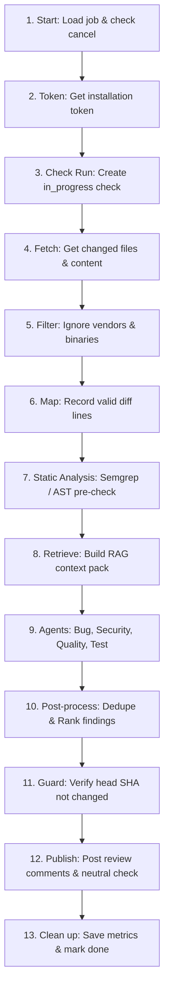

# AI Code Review Platform Architecture

An enterprise-grade, context-aware GitHub App that performs automated pull request reviews using whole-codebase context (RAG), static analysis pre-checks, specialist multi-agent reasoning, and automated evaluation benchmarks.

```
                              ┌──────────────────────────────────────┐
                              │           GitHub Webhooks            │
                              └──────────────────┬───────────────────┘
                                                 │ POST /webhooks/github (HMAC-SHA256)
                                                 ▼
                              ┌──────────────────────────────────────┐
                              │          Express API Server          │
                              │  - Raw body signature verification   │
                              │  - Idempotent delivery dedupe (PK)   │
                              │  - Immediate 202 Accepted (< 1s)     │
                              └──────────────────┬───────────────────┘
                                                 │ Enqueue review job
                                                 ▼
                              ┌──────────────────────────────────────┐
                              │         Redis Queues (BullMQ)        │
                              │  - review queue & index queue        │
                              │  - Debounce delay & stale cancel     │
                              └──────────────────┬───────────────────┘
                                                 │ Worker picks up job
                                                 ▼
                              ┌──────────────────────────────────────┐
                              │            Worker Service            │
                              │  1. Check cancel flag in Redis       │
                              │  2. Fetch PR diff & head commit files│
                              │  3. Map valid right-side diff lines  │
                              │  4. Run static tools (Semgrep/AST)   │
                              │  5. Retrieve RAG context pack        │
                              │  6. Execute LangGraph agents         │
                              │  7. Skeptic verifier pass            │
                              │  8. Dedupe, boost, rank, comment cap │
                              │  9. Confirm head SHA & post review   │
                              └───────┬──────────────┬───────────────┘
                                      │              │
                    Fetch/Post Review │              │ Query Vectors & Call Graph
                                      ▼              ▼
                     ┌──────────────────┐          ┌───────────────────────┐
                     │    GitHub REST   │          │  PostgreSQL 16        │
                     │    Checks & PRs  │          │  + pgvector           │
                     └──────────────────┘          └───────────────────────┘
```

## The 13 Pipeline Stages



## Database Schema (PostgreSQL + pgvector)

- `installations`: Tenant boundaries with GitHub installation IDs.
- `repos`: Repositories with custom review policies, branch metadata, and index statuses.
- `webhook_deliveries`: Primary key idempotency store for `X-GitHub-Delivery`.
- `reviews`: Per-review run states (queued, running, done, failed, cancelled) with token counts and cost tracking.
- `findings`: Canonical findings with severity, category, evidence, suggested fixes, confidence, and fingerprints.
- `feedback`: Developer thumbs up (+1) and thumbs down (-1) signals feeding the adaptive threshold loop.
- `code_chunks`: 1536-dimensional vector embeddings with HNSW indexing and GIN `tsvector` keyword search.
- `symbol_edges`: Call graph edges mapping function callers and callees.
- `eval_runs`: History of evaluation runs tracking precision, recall, and false-positive rates over time.

